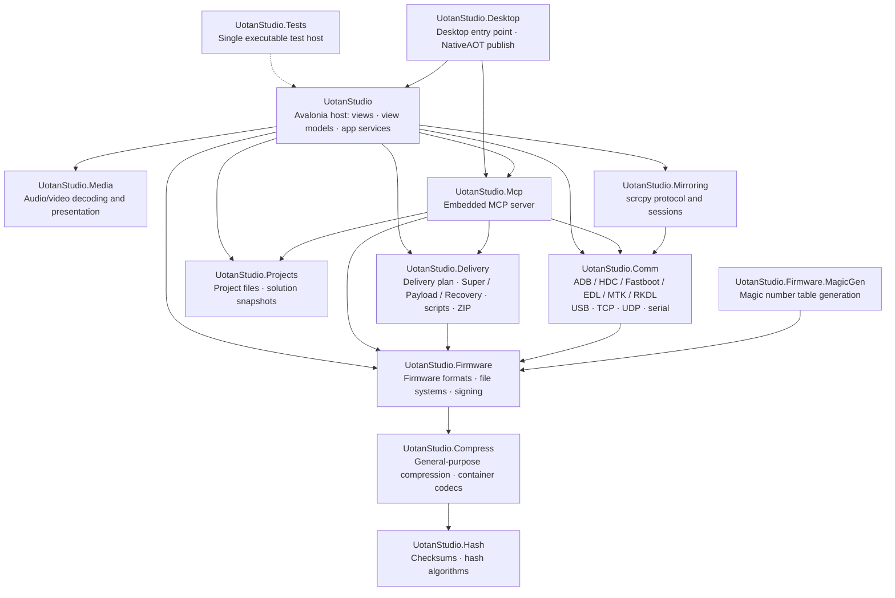

<a href="README.md">查看中文说明</a>

<div id="header" align="center">
 <h3>UotanStudio</h3>
 <h4><i>An integrated toolbox for firmware unpack/pack, board flashing and visual programming</i></h4>
 <div id="badges">
  <a href="https://www.uotan.cn/">
   
  </a>
  
  
  
  
 </div>
</div>
<br/>

## ✨ Features

- 🍀 Cross-platform: Windows, Linux and macOS on x64, ARM64, LoongArch64 and RVA23
- 📦 Firmware parsing and rebuilding: file systems, partitions, OTA, boot images and vendor packages
- 🔌 Device communication: ADB, HDC, Fastboot, Qualcomm EDL, MediaTek and Rockchip RKDL over USB/TCP/UDP/serial
- 🛠 Visual programming: node canvas, workflow templates, script nodes and plugin packages
- 🤖 Embedded MCP server: companion mode inside the GUI and a headless mode for AI clients
- 🖥 Screen mirroring: scrcpy protocol with GPU presentation and a CPU bitmap fallback
- 🌍 Multilingual UI: Simplified Chinese and English
- 🚫 No ads, no telemetry: parsing, packaging and flashing all run locally; the network is used only to download external tools on demand
- ⚡ NativeAOT publishing: self-contained output that needs no .NET runtime on the target machine

## 🧩 Architecture

The edges below match the `ProjectReference` entries in each project file.



- `UotanStudio.Hash` and `UotanStudio.Net` are the lowest leaves; `UotanStudio.Compress` depends only on `Hash` and provides general-purpose compression plus ZIP/container codecs, and `UotanStudio.Firmware` depends on `UotanStudio.Compress` in turn. `UotanStudio.Projects` depends on `Hash` and `Compress`; `UotanStudio.Media` depends on no other business project.
- The test host really references every project except `UotanStudio.Desktop`; the diagram draws one representative dashed edge for it.
- `UotanStudio.Comm` owns every device access path (USB handles, sockets, serial ports, adb/HDC server protocols); the host only consumes `DeviceController`/`DeviceLease` and the protocol clients.
- `UotanStudio.Delivery` may use the firmware layer but never references host UI, project services or the key library; signing reaches it through `IDeliverySigningKeyProvider`.
- `UotanStudio.Mirroring` references only `UotanStudio.Comm`, while `UotanStudio.Media` keeps zero Comm dependencies and consumes frames through the decoding factory.
- `UotanStudio.Net` is the leaf library for downloads, GitHub mirrors and release/version queries; it references no other project.
- `UotanStudio.Benchmarks` is a BenchmarkDotNet console app now included in the `.slnx` build and CI gates; benchmarks still run separately in Release.

## 📦 Firmware formats

Detection follows the handler list published by `FirmwareFormatRegistry.RegisterAll()`: extension candidates are always confirmed by a content check.

| Area | Formats |
| --- | --- |
| Archives and compression | ZIP, CPIO; Brotli, Bzip2, Deflate, Gzip, LZ4, LZO, LZMA, XZ, Zlib, Zstd (the compression algorithms and container codecs are provided by `UotanStudio.Compress`) |
| File systems | ext4, EROFS, F2FS, SquashFS, ROMFS, FAT12/16/32, exFAT (ext4, EROFS and F2FS support building from scratch and rebuilding) |
| Partitions and block devices | GPT, Android LP (`super`), sparse images, partition editor with per-partition read and write |
| OTA and deltas | `payload.bin`, `.transfer.list` + `.new.dat`/`.new.dat.br` + `.patch.dat`, care_map |
| Boot and security | boot / recovery / vendor_boot / dtbo parsing and repacking, AVB descriptor verification and signing, hashtree and FEC construction, SELinux policy parsing, boot patch footprint analysis |
| Android metadata | `resources.arsc`, binary XML, DEX decompilation and Smali, OAT/VDEX, APK parsing and repacking, v1/v2/v3 signing with JKS key stores, QCN modem configuration |
| Device tree and executables | DTB/DTS editing, ELF inspection, Qualcomm images and PBT |
| Vendor packages | OPPO/OnePlus (`.ops`), Meizu MPK, Lenovo QSB, Huawei UpdateApp, Rockchip PAC/IMG, Amlogic DZ/KDZ, Allwinner, MediaTek, Sony SIN, NTPi, NB0 |

Firmware images, ZIP files, payloads, file system images and device responses are all treated as untrusted input: offsets, lengths, entry counts, decompressed sizes and block counts are bounded and overflow-checked, and every publish goes through a temporary directory plus verification and atomic replacement.

## 🔌 Device communication

- **ADB**: direct USB and TCP, server routing, shell, sync file transfer, `localabstract` multiplexing, wireless debugging pairing (QR plus mDNS discovery)
- **Fastboot**: device profiles and variants, per-partition flashing with `download`/`upload` read-back, pre-flight checks, unlock capability query
- **HDC**: HarmonyOS / OpenHarmony device channel and app management
- **Qualcomm EDL**: Sahara handshake and transfer, Firehose flash/read/erase, partition operations named from the device GPT, GPT repair, UFS descriptors and provisioning plans, memory debug and crash dump, project-level authentication
- **MediaTek**: XFlash and Legacy DA paths, BootROM and DA interaction, chip table, scatter/GPT plans, DA patching and digest repair
- **Rockchip RKDL**: BootROM USB protocol, fail-closed geometry checks, transfer and flashing
- **Native USB**: interface selection by exact physical path, with libusb natives bundled per RID

Device-side capabilities surface in the device panel, USB tree view, device log, QR pairing window, mirroring window and the embedded terminal.

## 🚀 Delivery packaging and scripts

- `DeliveryPlan` is the input contract for the delivery backend; the mutual exclusion between Super, Payload, Recovery and pure-script modes lives in the single validation path.
- DAT/BR files are associated through the partition's own `.transfer.list`, `.new.dat`/`.new.dat.br` and patch files rather than by guessing from any suffix.
- Recovery scripts use the verified Edify capabilities supplied by the source package (`block_image_verify`, `block_image_update`, `package_extract_file`, `file_getprop`); shell commands are never presented as recovery scripts.
- Windows bat, Linux/macOS shell and recovery scripts share one file-orchestration result; compressed images are decompressed by the script before being handed to fastboot.
- Publishing uses temporary directories, checksums and atomic replacement, so an existing output survives a failed run.
- Tool preparation downloads the pinned platform-tools and zstd for each target platform and verifies their SHA-256 (riscv64 zstd binaries are out of scope).

## 🖥 Workspace and automation

- Dock workspace: project explorer, packaging settings, properties, output and device logs, terminal, image management, all dockable and detachable
- Editors: hex, text/log, file manager, APK, ARSC, DEX, DTB, ELF, QCN, partition, manifest, firmware info, Qualcomm image
- Tool windows: flash, file and folder compare, checksum, key manager, APK signer, boot patch, plugin manager
- Visual programming: node canvas, workflow templates, composite nodes, Lua script nodes, plugin package import and enable/disable
- MCP: `--mcp-headless` runs the stdio server without a GUI, `--mcp` starts the companion server next to the GUI, `--mcp-root <dir>` restricts the path sandbox, `--allow-flash` explicitly enables flashing; the settings page can expose Streamable HTTP on `127.0.0.1` only
- Command line: `--managed-device-shell <Adb|Hdc> <serial>` runs an interactive shell through the existing server channel; passing file paths opens them through the registered file associations

## ⚙️ Development

Build, run and verify:

```bash
dotnet restore UotanStudio.slnx
dotnet build UotanStudio.slnx --no-restore --nologo
dotnet format UotanStudio.slnx whitespace --no-restore --verify-no-changes
dotnet format UotanStudio.slnx style --no-restore --verify-no-changes
dotnet test --solution UotanStudio.slnx --no-restore
```

Targeted runs use the native xunit.v3 filters:

```bash
dotnet test --project UotanStudio.Tests/UotanStudio.Tests.csproj --no-build \
  --filter-class UotanStudio.Tests.Firmware.ErofsTests --minimum-expected-tests 1
dotnet test --project UotanStudio.Tests/UotanStudio.Tests.csproj --no-build \
  --filter "FullyQualifiedName~ChecksumServiceTests" --minimum-expected-tests 1
```

Benchmarks run on their own:

```bash
dotnet run -c Release --project UotanStudio.Benchmarks -- --filter <BenchmarkName>
```

## 🧾 License and notes

- This project is published under the GNU General Public License v3.0; see `LICENSE.txt`.
- The About dialog lists the open-source components used by or referenced in this application together with their licenses. The UI uses the MiSans font, whose copyright belongs to Xiaomi Inc.
- Flashing, erasing, patching boot images, unlocking and authentication bypass all change device state and can leave a device unusable. Use your own devices, take a full backup first, and make sure you are authorized to operate the target.

## Star History

[](https://star-history.com/#Uotan-Dev/UotanStudio&Date)
