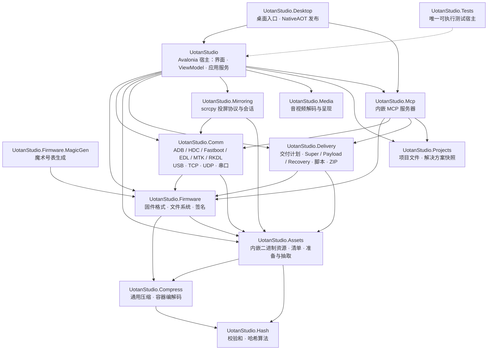

<a href="README-EN.md">Go to English version</a>

<div id="header" align="center">
 <h3>UotanStudio</h3>
 <h4><i>集固件解打包、开发板烧录与可视化编程于一体的一站式工具箱</i></h4>
 <div id="badges">
  <a href="https://www.uotan.cn/">
   
  </a>
  
  
  
  
 </div>
</div>
<br/>

## ✨ 特点

- 🍀 跨平台：Windows、Linux、macOS，x64、ARM64、LoongArch64、RVA23
- 📦 固件解析与重建：文件系统、分区、OTA、启动镜像、厂商包
- 🔌 设备通信：ADB、HDC、Fastboot、高通 EDL、MTK、Rockchip RKDL，USB/TCP/UDP/串口全覆盖
- 🛠 可视化编程：节点画布、工作流模板、脚本节点与插件包
- 🤖 内嵌 MCP 服务器：桌面伴随模式与无头模式，供 AI 客户端调用固件与设备能力
- 🖥 设备投屏：scrcpy 协议，GPU 呈现 + CPU 位图回退
- 🌍 多语言界面：简体中文与英文
- 🚫 无广告、无遥测：解析、打包、烧录全部在本机完成，联网只用于按需下载外部工具
- ⚡ NativeAOT 发布：自包含单目录产物，目标机器无需安装 .NET 运行时

## 🧩 项目架构

下图的引用关系与各项目 `.csproj` 中的 `ProjectReference` 一致。



- `UotanStudio.Hash` 与 `UotanStudio.Net` 是最底层叶子；`UotanStudio.Compress` 只依赖 `Hash` 并提供通用压缩与 ZIP/容器编解码，`UotanStudio.Firmware` 再依赖 `UotanStudio.Compress`；`UotanStudio.Projects` 依赖 `Hash` 与 `Compress`，`UotanStudio.Media` 不依赖其他业务项目。
- `UotanStudio.Assets` 只依赖 `Hash` 与 `Compress`，是全部随包二进制资源的唯一存放点（字体、OpenHarmony 采集库、厂商驱动包、交付更新器、magic 规则表）；`Firmware`、`Comm`、`Mirroring`、`Delivery` 与宿主经 `AssetCatalog`/`AssetStore` 读取，任何项目都不再自己内嵌资源。
- 厂商 Windows 驱动以 `drivers/<packageId>` 资源包随包，设置页的驱动安装器经 `AssetStore` 物化到临时目录后暂存到驱动仓库。
- 测试宿主实际引用除 `UotanStudio.Desktop` 之外的全部项目，图中只画出一条代表性依赖。
- 全部设备读写（USB 句柄、套接字、串口、adb/HDC server 协议）由 `UotanStudio.Comm` 持有，宿主只消费 `DeviceController`/`DeviceLease` 与协议客户端。
- `UotanStudio.Delivery` 可引用固件层，但不得反向引用宿主 UI、项目服务或密钥库；签名能力通过 `IDeliverySigningKeyProvider` 注入。
- `UotanStudio.Mirroring` 只引用 `UotanStudio.Comm`，`UotanStudio.Media` 保持零 Comm 依赖，经解码工厂消费帧数据。
- `UotanStudio.Net` 是下载、GitHub 镜像与 Release/版本查询的叶子库，不引用任何其他项目。
- `UotanStudio.Benchmarks` 是 BenchmarkDotNet 控制台程序，已在 `.slnx` 与 CI 构建门内；基准运行仍需单独 Release 执行。

## 📦 固件格式

格式识别以 `FirmwareFormatRegistry.RegisterAll()` 注册的处理器清单为准：先按扩展名候选，再用内容校验确认。

| 类别 | 格式 |
| --- | --- |
| 归档与压缩 | ZIP、CPIO；Brotli、Bzip2、Deflate、Gzip、LZ4、LZO、LZMA、XZ、Zlib、Zstd（压缩算法与容器编解码由 `UotanStudio.Compress` 提供） |
| 文件系统 | ext4、EROFS、F2FS、SquashFS、ROMFS、FAT12/16/32、exFAT（ext4、EROFS、F2FS 支持从零构建与重建） |
| 分区与块设备 | GPT、Android LP（`super`）、sparse 镜像、按分区名读写的分区编辑器 |
| OTA 与增量 | `payload.bin`、`.transfer.list` + `.new.dat`/`.new.dat.br` + `.patch.dat`、care_map |
| 启动与安全 | boot / recovery / vendor_boot / dtbo 解析与重打包、AVB 描述符校验与签名、hashtree 与 FEC 构建、SELinux 策略解析、boot 补丁痕迹分析 |
| Android 元数据 | `resources.arsc`、二进制 XML、DEX 反编译与 Smali、OAT/VDEX、APK 解析与重打包、v1/v2/v3 签名与 JKS 密钥库、QCN 调制解调器配置 |
| 设备树与可执行 | DTB/DTS 编辑、ELF 信息、Qualcomm 镜像与 PBT |
| 厂商包 | OPPO/OnePlus（`.ops`）、Meizu MPK、Lenovo QSB、酷派 CPB、华为 UpdateApp、Rockchip PAC/IMG 与 RKBOOT/RKLOADER loader、Amlogic DZ/KDZ、Allwinner、MediaTek、Sony SIN、NTPi、NB0 |

固件、ZIP、Payload、文件系统镜像和设备返回数据一律视为不可信输入：偏移、长度、条目数量、解压大小和块数量都有上限检查与溢出防护，写入统一走临时目录 + 校验 + 原子替换。

## 🔌 设备通信

- **ADB**：USB 与 TCP 直连、server 路由、shell、sync 文件传输、`localabstract` 多流、无线调试配对（QR + mDNS 发现）
- **Fastboot**：变体与设备 profile、按分区刷写与 `download`/`upload` 读回、刷写前预检、解锁能力查询
- **HDC**：HarmonyOS / OpenHarmony 设备通道与应用管理
- **Qualcomm EDL**：Sahara 握手与传输、Firehose 刷写/读取/擦除、按 GPT 分区名操作、GPT 修复、UFS 描述符与 provision 计划、内存调试与 crashdump、项目级认证
- **MediaTek**：XFlash、Legacy DA、BootROM 与 DA 交互、芯片表、scatter/GPT 计划、DA 补丁与摘要修复
- **Rockchip RKDL**：BootROM USB 协议、几何校验、传输与刷写
- **原生 USB**：按物理路径精确筛选接口，libusb 原生库按 RID 随包提供

设备侧能力对应界面：设备面板、USB 树视图、设备日志、扫码配对窗口、投屏窗口与内置终端。

## 🚀 交付打包与脚本

- `DeliveryPlan` 是交付后端的输入契约，Super、Payload、Recovery 与纯脚本模式的互斥关系由统一校验路径负责。
- DAT/BR 文件按分区与同组 `.transfer.list`、`.new.dat`/`.new.dat.br`、补丁文件关联，不靠任意后缀猜测。
- 卡刷脚本使用原包提供且经过校验的 Edify 能力（`block_image_verify`、`block_image_update`、`package_extract_file`、`file_getprop`），不把 shell 命令冒充卡刷脚本。
- Windows bat、Linux/macOS shell 与卡刷脚本共用同一份文件编排结果；压缩镜像先由脚本解压再交给 fastboot。
- 输出发布使用临时目录、校验和原子替换；失败时保留既有输出。
- 工具准备按目标平台下载钉定版本的 platform-tools 与 zstd 并校验 SHA-256（riscv64 二进制不在支持范围内）。

## 🖥 工作区与自动化

- Dock 工作区：项目资源管理器、打包设置、属性、输出/设备日志、终端、镜像管理，可停靠、可拖出
- 编辑器：十六进制、文本/日志、文件管理、APK、ARSC、DEX、DTB、ELF、QCN、分区、清单、固件信息、Qualcomm 镜像
- 工具窗口：烧录、文件与文件夹比较、校验器、密钥管理、APK 签名器、Boot 修补、插件管理器
- 可视化编程：节点画布、工作流模板、复合节点、Lua 脚本节点、插件包导入与启停
- MCP：`--mcp-headless` 以 stdio 运行无头服务器，`--mcp` 在 GUI 内启动伴随服务器，`--mcp-root <目录>` 限定路径沙箱，`--allow-flash` 显式放开刷写；设置页可开启仅监听 `127.0.0.1` 的 Streamable HTTP
- 命令行：`--managed-device-shell <Adb|Hdc> <serial>` 在当前终端复用 server 通道执行交互 shell；直接传入文件路径可按文件关联打开

## ⚙️ 开发

构建、运行与验证：

```bash
dotnet restore UotanStudio.slnx
dotnet build UotanStudio.slnx --no-restore --nologo
dotnet format UotanStudio.slnx whitespace --no-restore --verify-no-changes
dotnet format UotanStudio.slnx style --no-restore --verify-no-changes
dotnet test --solution UotanStudio.slnx --no-restore
```

定向测试使用 xunit.v3 原生过滤器：

```bash
dotnet test --project UotanStudio.Tests/UotanStudio.Tests.csproj --no-build \
  --filter-class UotanStudio.Tests.Firmware.ErofsTests --minimum-expected-tests 1
dotnet test --project UotanStudio.Tests/UotanStudio.Tests.csproj --no-build \
  --filter "FullyQualifiedName~ChecksumServiceTests" --minimum-expected-tests 1
```

基准测试项目独立运行：

```bash
dotnet run -c Release --project UotanStudio.Benchmarks -- --filter <BenchmarkName>
```

## 🧾 许可与说明

- 本项目在 GNU General Public License v3.0 下发布，详见 `LICENSE.txt`。
- 关于对话框列出了本项目使用或参考的开源组件及其许可证；界面使用 MiSans 字体，字体版权归 Xiaomi Inc. 所有。
- 烧录、擦除、修补 Boot、解锁与绕过认证都会改变设备状态并可能使设备不可用。请使用自己的设备，先做完整备份，并确认你对目标设备拥有相应权限。

## Star 历史

[](https://star-history.com/#Uotan-Dev/UotanStudio&Date)
