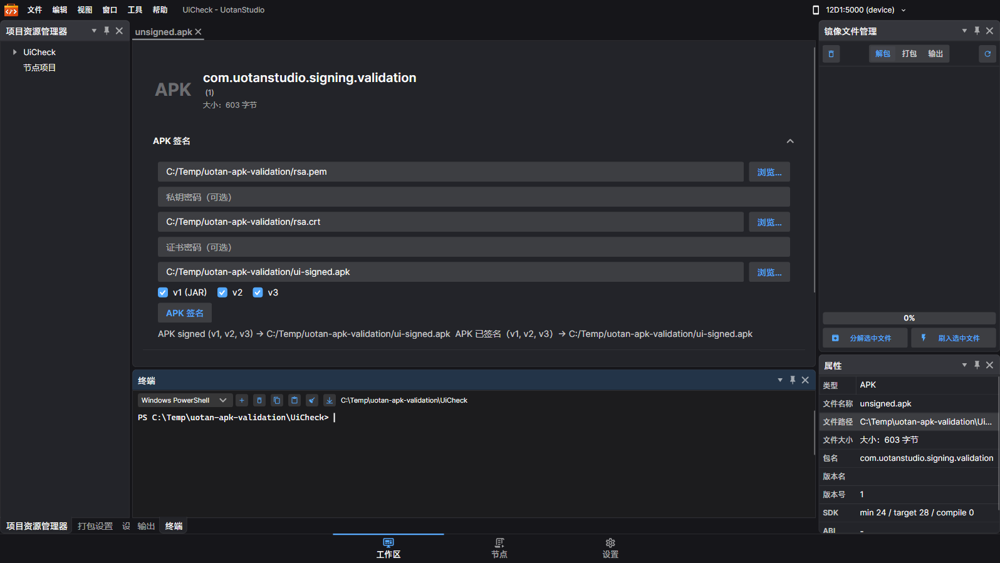

# APK 签名补全与验证（2026-09-09）

## 完成内容

- APK 文档页增加“APK 签名”：私钥、证书、输出路径、文件选择器、遮蔽密码、v1/v2/v3 开关、异步执行与取消。密码仅保存在内存中，操作结束清空。
- 节点工具箱“固件”分类增加 `Firmware.SignApk`，工厂注册供界面和无头工作流共用。输入为 `APK Path`、`Output Path`、`Private Key`、`Certificate`、`V1/V2/V3`；输出为 `Signed APK`、`Report`。可选密码通过 `Key Password Environment`、`Certificate Password Environment` 指定环境变量名。失败抛给引擎，工作流 CLI 返回 1。
- 复用已有 `FirmwareService.SignApkAsync` 与 `firmware sign` 后端，继续使用用户自定义 RSA/EC 密钥，不内置产品签名密钥。私钥支持 PKCS#8/PKCS#1/SEC1 的 PEM/DER，证书支持 PEM/DER/PFX；PFX 在当前入口作为证书使用，仍需指定独立私钥。
- 拒绝全部关闭方案、输入输出同路径、无效 v3 SDK 范围、无效 JAR 签名者名、私钥与证书不匹配。临时输出使用随机名称，取消或失败不替换最终文件。

## 上游依据与修复

逐项对照 Google Maven 发布的 **apksig 8.9.2 源码**，对应源码文件：

| 上游文件 | 对齐的定义与修复 |
|---|---|
| `internal/apk/ApkSigningBlockUtils.java` | 摘要计算时 EOCD 的中央目录偏移指向签名块起点；实际输出的 EOCD 则指向签名块之后。移除占位签名测长和二次签名，避免 ECDSA DER 长度变化造成失败。空数据区段贡献零个摘要块。 |
| `internal/apk/v2/V2SchemeSigner.java` | RSA 采用 PKCS#1 v1.5；RSA >3072 位、EC >256 位选 SHA-512，否则 SHA-256。组合启用 v3 时写入 v2 的 `0xbeeff00d` 防剥离属性。 |
| `internal/apk/SignatureAlgorithm.java` | ECDSA 签名使用 DER 编码的 `(r,s)` 序列，不能使用 .NET 默认的固定宽度拼接编码。 |
| `internal/apk/v1/V1SchemeSigner.java`、`ApkSigningBlockUtils.java` | `.SF` 写入 `SHA-256-Digest-Manifest` 和每个清单段的摘要；CMS 为分离式签名，使用 IssuerAndSerialNumber 和显式 SHA-256。 |
| ZIP 条目布局 | 修复 `ApkRepacker` 写完文件头后再次跳过文件头长度导致的内容损坏；重写 APK 时维持已有 STORED 条目的对齐。 |

v1 解压摘要按条目声明长度精确读取，64 GiB 总解压预算、32 MiB 清单预算，逐块检查取消。密钥/证书文件上限为 4 MiB。v2/v3 摘要使用 1 MiB 数据块并验证 ZIP32 范围，不把整个 APK 读入内存。

固定工具来源与 SHA-256：

- [apksig 8.9.2 jar](https://dl.google.com/dl/android/maven2/com/android/tools/build/apksig/8.9.2/apksig-8.9.2.jar)：`C070ED1394629D74641AA0906F60B2FFA1EE77E6366A1F93437F59717B1AEB89`。
- [apksig 8.9.2 sources.jar](https://dl.google.com/dl/android/maven2/com/android/tools/build/apksig/8.9.2/apksig-8.9.2-sources.jar)：`C7A0F43D1E40FDF39725AC090F5C7BBAEAE82D1E0BFD9CF2EE507A70EB5136B5`。
- 格式规范：[APK Signature Scheme v2](https://source.android.com/docs/security/features/apksigning/v2)、[v3](https://source.android.com/docs/security/features/apksigning/v3)。

## 实测结果

### 构建与自动化测试

`dotnet build UotanStudio.slnx -c Debug /p:UseSharedCompilation=false` 成功。APK 签名、APK 解包、固件 CLI、工作流 CLI 相关测试 **61 项全部通过，0 跳过**。这是相关测试集，不是全解决方案所有测试的执行结果。

新增上游交叉测试覆盖：

- RSA-2048、EC P-256 的 v1/v2/v3 单独签名与组合签名。
- RSA-4096、EC P-384 的 SHA-512 组合签名。
- 上游生成签名 → 本项目剥离并重签名 → 上游接受结果。
- 篡改后上游拒绝；未启用任何方案、同路径输出、密钥不匹配、空摘要区段、STORED/DEFLATE 内容实际读取等回归。

另有手工独立矩阵：RSA-2048/4096、EC P-256/P-384 各自的 v1、v2、v3、组合方案，共 **16 种**均通过上游验证。测试代码和运行依赖说明位于 `UotanStudio.Tests/TestInfrastructure/ApkSigning/`；测试不自行下载依赖，也不操作设备。

### 实际界面与节点工作流

重新构建并启动真实 Desktop 应用，加载 APK 文档，填入测试私钥、证书、输出路径，通过真实按钮命令完成签名。截图如下。随后用 apksig 检查该按钮生成的文件，结果为 `verified=true v1=true v2=true v3=true`（检查 API 21–35）。

保存的 `Firmware.SignApk` 节点经 `workflow run` 成功执行；关闭所有方案时返回退出码 1。界面产物与节点产物 SHA-256 相同：

`630B37AB19FC07F11FFA0F0A118301FFE22E45198159286987C36BB016B00414`

### ADB 模拟器安装

使用已有 ADB 服务与连接，明确选择 **`emulator-5556`**：MuMu，Android 15 / API 35，指纹 `HUAWEI/Allen/Allen:15/V417IR/972:user/release-keys`。另一个在线入口为 `127.0.0.1:16416`，测试均显式限定前者。

测试包为无代码 APK `com.uotanstudio.signing.validation`，不申请权限，没有 Activity 或业务代码。验证的是包安装/更新，不是应用运行行为。最初查询该包不存在，测试结束已卸载。

| 操作 | 实测结果 |
|---|---|
| RSA 组合签名首次安装 | Success |
| 同 RSA 证书的 v2、v3、v1 分别覆盖更新 | 全部 Success |
| ECDSA 证书尝试覆盖 RSA 安装包 | `INSTALL_FAILED_UPDATE_INCOMPATIBLE`，符合签名身份不匹配预期 |
| 卸载测试包后 ECDSA 组合签名首次安装 | Success |
| 同 EC 证书的 v2、v3、v1 分别覆盖更新 | 全部 Success |
| 实际界面签名产物安装、节点工作流产物更新 | 全部 Success |
| 篡改资产内容后覆盖安装 | **异常：仍返回 Success** |
| 卸载测试包后全新安装同一篡改包 | **异常：仍返回 Success** |

**模拟器安装成功不能作为完整性验签证据。** 独立 apksig 对篡改样本明确返回 `APK integrity check failed. CHUNKED_SHA256 digest mismatch`。卸载后全新安装仍成功，且通过 ADB 拉取的设备 `base.apk` 与本地篡改文件 SHA-256 一致：

`81E34F03C887C9EACE30E597D1FEF10E869774A34B944242DE002407C5B36083`

这排除了仅安装到旧文件、更新缓存或误认产物的解释，但未进一步定位 MuMu 内部放行原因，不能推断具体补丁或设置。已保留安装兼容性结论，完整性结论以独立上游验签为准。

### 真实 APK 样本

对本机 `Magisk-v30.6.apk`（12,919,431 字节）使用固件 CLI 重签名，再交给 apksig 验证，得到 `verified=true v1=true v2=true v3=true`（API 23–35）。仅做离线验证，未在模拟器安装或启动 Magisk。

- 原始样本 SHA-256：`F1FFC3C9A5614C251BA6BADA308163ACC3C3D844CF01D33F55A8BC151ADC34CE`。
- 重签名产物 SHA-256：`8D10469D96FC0152CF629CEA69D6F92C280D2AC0E13B1101D6D4A644993D2DAB`。

apksig 对该样本的 `META-INF/com/google/android/*`、`META-INF/services/*` 等条目给出 JAR/v1 不保护 META-INF 内容的警告；v2/v3 的 APK 内容摘要仍覆盖这些字节。

## 证据边界

- 当前平台 SignedCms 生成的 ECDSA v1 算法标识不兼容 Android API 18–20；独立检查确认 API 21+ 通过。不宣称支持全部旧 Android 版本。
- 未实现 JKS/Java KeyStore 直接导入、APK v3.1/v4、密钥轮换证明、多签名者或 source stamp。
- 没有进行 Release/NativeAOT 发布验证；保留源生成/编译期注册约定，Debug 桌面构建与实际 UI 操作已验证。
- 工作区存在其他未提交且持续变化的修改。本任务额外修正了 HDC 构建中两个小阻断：移除已不适用的类级 XML 参数注释、给新增 HDC 测试补充 Xunit 引用；不把其他 HDC、投屏等功能计入本任务结果。
